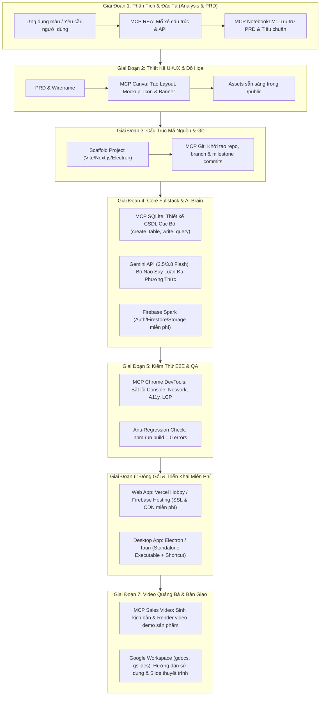

# Closed-Loop MCP Application Creation Pipeline (Quy Trình Tạo App Khép Kín A - Z)

> [!IMPORTANT]
> Đây là quy trình tiêu chuẩn bắt buộc thực hiện mỗi khi người dùng yêu cầu tạo mới, nhân bản (clone) hoặc xây dựng hoàn thiện một ứng dụng từ A đến Z.
> Hệ thống vận hành trên **100% Free-tier vĩnh viễn và công nghệ mã nguồn mở**, không yêu cầu thẻ tín dụng hay chi phí đám mây trả phí.

---

## 🗺️ Bản Đồ Vận Hành Khép Kín 7 Giai Đoạn

---

## 🛠️ Chi Tiết Triển Khai Từng Giai Đoạn

### Giai Đoạn 1: Phân Tích Kỹ Thuật & Lập Hồ Sơ Đặc Tả (Research & PRD)
* **Mục tiêu:** Hiểu sâu kiến trúc, luồng hoạt động, cấu trúc dữ liệu và API endpoints mà không phỏng đoán.
* **Công cụ cốt lõi:**
  - **MCP REA (`morluto/rea`):**
    - `analyze-web-bundle`, `analyze-javascript-application`: Bóc tách frontend bundle, routes, state management.
    - `extract-artifact`: Bung gói ASAR của Electron hoặc APK của Android để lấy source code nguyên bản.
    - `trace-application-feature`: Lần theo dấu vết luồng xử lý và socket IPC.
  - **MCP NotebookLM (`notebooklm`):**
    - `note_save`: Lưu trữ bản tóm tắt PRD, danh sách API, quy chuẩn giao diện và kiến trúc cơ sở dữ liệu.
    - `chat_ask`: Tra cứu tức thời các ràng buộc sư phạm/kỹ thuật trong sổ tay dự án.

### Giai Đoạn 2: Thiết Kế UI/UX & Tài Nguyên Trực Quan (Assets & Visual Design)
* **Mục tiêu:** Tạo nên bộ nhận diện thương hiệu, giao diện hiện đại, thân thiện và đầy đủ assets tĩnh.
* **Công cụ cốt lõi:**
  - **MCP Canva (`canva`):**
    - `search-brand-templates`, `create-design`: Tạo banner hero, layout mockup, bộ icon ứng dụng.
    - `export-design`: Xuất ảnh SVG/PNG chất lượng cao để đặt trực tiếp vào thư mục `/public/assets`.

### Giai Đoạn 3: Khởi Tạo Dự Án & Quản Lý Phiên Bản (Repo & Scaffolding)
* **Mục tiêu:** Cấu trúc dự án theo chuẩn module, bảo đảm an toàn mã nguồn từ commit đầu tiên.
* **Công cụ cốt lõi:**
  - **MCP Git (`git` / `mcp-server-git`):**
    - `git_status`: Kiểm tra trạng thái vùng làm việc.
    - `git_add`: Đưa các tệp source code vào staging.
    - `git_commit`: Đóng gói milestone (`feat: init scaffold`, `feat: add core logic`).
    - `git_create_branch`, `git_checkout`: Phân nhánh tính năng độc lập, bảo vệ nhánh `main`.

### Giai Đoạn 4: Phát Triển Fullstack & Trí Tuệ Nhân Tạo (Fullstack & AI Engine)
* **Mục tiêu:** Hiện thực hóa logic nghiệp vụ, quản trị dữ liệu cục bộ và năng lực suy luận thông minh.
* **Công cụ cốt lõi:**
  - **MCP SQLite (`sqlite` / `mcp-server-sqlite`):**
    - `create_table`: Định nghĩa cấu trúc bảng (users, sessions, history, configs) không tốn phí cloud.
    - `write_query`: Thêm, sửa, xóa dữ liệu cục bộ với tốc độ mili-giây.
    - `read_query`: Truy vấn dữ liệu có cấu trúc phục vụ UI.
  - **Google Gemini API SDK:**
    - Sử dụng mô hình `gemini-2.5-flash` hoặc `gemini-3.8-flash` qua Google AI Studio miễn phí (15 RPM, 1500 RPD) để thực hiện ReAct agent loop, hiểu hình ảnh đa phương thức (Multimodal Vision) và trả về dữ liệu JSON có cấu trúc.
  - **Firebase Spark:**
    - Xác thực người dùng (Auth) và đồng bộ realtime (Firestore) khi cần tính năng đồng bộ trực tuyến.

### Giai Đoạn 5: Kiểm Thử Tự Động & Đảm Bảo Chất Lượng (E2E Testing & Auditing)
* **Mục tiêu:** Đảm bảo 0 lỗi giao diện, 0 lỗi runtime, tối ưu tốc độ tải và khả năng tiếp cận.
* **Công cụ cốt lõi:**
  - **MCP Chrome DevTools (`chrome-devtools-mcp`):**
    - `navigate_page`: Mở URL ứng dụng (`http://localhost:PORT`).
    - `list_console_messages`: Đảm bảo không có lỗi JavaScript đỏ (Uncaught TypeError, 404 assets).
    - `list_network_requests`: Kiểm tra phản hồi API và mã trạng thái HTTP (200 OK).
    - `lighthouse_audit`: Đánh giá Performance, Accessibility, Best Practices, SEO.
  - **Anti-Regression Protocol:** Chạy `npm run build` xác nhận xuất xưởng với **0 errors**.

### Giai Đoạn 6: Đóng Gói & Triển Khai Miễn Phí (Free Deployment & Packaging)
* **Mục tiêu:** Đưa ứng dụng vào sử dụng thực tế tức thì.
* **Công nghệ:**
  - **Web Application:** Triển khai bằng Vercel CLI hoặc Firebase Hosting (`firebase deploy --only hosting`) hoàn toàn miễn phí, hỗ trợ custom domain và HTTPS tự động.
  - **Desktop Application:** Đóng gói bằng Electron/Tauri, tự động tạo file thực thi `.bat` hoặc Desktop Shortcut (`.lnk`) với đường dẫn 8.3 ShortPath chống lỗi Unicode tiếng Việt.

### Giai Đoạn 7: Video Bán Hàng, Trình Diễn & Bàn Giao (Showroom & Docs)
* **Mục tiêu:** Quảng bá sản phẩm, làm video demo bắt mắt và cung cấp tài liệu bàn giao rõ ràng.
* **Công cụ cốt lõi:**
  - **MCP Sales Video (`sales-video-mcp`):**
    - `generate_sales_script`: Soạn kịch bản giới thiệu theo mô hình AIDA / Problem-Solution.
    - `generate_voiceover`: Tạo file lồng tiếng chuẩn AI tiếng Việt (`vi-VN-NamMinhNeural` hoặc `vi-VN-HoaiMyNeural`).
    - `render_sales_video`: Render video thành phẩm định dạng 9:16 dọc hoặc 16:9 ngang có phụ đề và hiệu ứng.
  - **Google Workspace (`gdocs`, `gslides`):**
    - Tạo tài liệu hướng dẫn kỹ thuật trên Docs và Slide thuyết trình trên Slides sẵn sàng chia sẻ.
